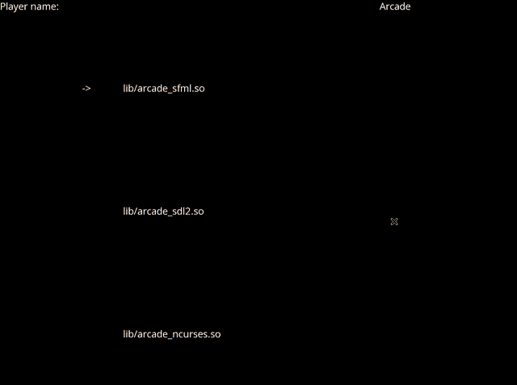

<div align="center">

# Arcade

**A retro gaming platform where games and graphics libraries are plugins you can swap while playing.**

   

<sub>Team of 2 · March – April 2024</sub>

</div>

<p align="center"></p>
<p align="center"><sub>Menu, Pacman, then Nibbler, all running through the SFML graphics plugin.</sub></p>


## About the project

Arcade is a small game platform. The **core** knows nothing about any specific game or any specific way of drawing: both are loaded at runtime from shared libraries (`dlopen`). That means you can switch from the SFML renderer to SDL2 or to a terminal (ncurses) in the middle of a game, and from Pacman to Nibbler, without restarting.

```
core/      loads plugins, runs the main loop, tracks scores
games/     Menu · Pacman · Nibbler          (IGameModule)
display/   SFML · SDL2 · ncurses            (IDisplayModule)
doc/       architecture diagram and full documentation
```

## Build and run

```bash
make                         # core + games + graphical libraries
./arcade lib/arcade_sfml.so  # start with any graphical library
```

Needs SFML, SDL2 (with image and ttf) and ncurses development packages.

| Key | Action |
|---|---|
| `Arrows` | Move |
| `Enter` | Select in the menu |
| `N` / `P` | Next / previous graphical library |
| `G` | Switch game |
| `R` | Restart |
| `M` | Back to the menu |
| `Backspace` | Quit |

Scores are saved per game in a `.<game>.scores` file. The interfaces, enums and design are described in [`doc/ARCADE_DOCUMENTATION.md`](doc/ARCADE_DOCUMENTATION.md).

## My contribution

35 of the project's 72 commits (about 2,300 lines added), shared with Yanis Harkouk.

- **The three graphics libraries**: SDL2, SFML and ncurses implementations of the display interface, so every game renders identically on each
- **Games**: Pacman (ghosts, win condition, scoring) and Nibbler, plus the in-platform menu
- **Core**: dynamic library loading, switching between two games, handling the previous and next graphical library
- **Documentation**: the diagram and written documentation in `doc/`

## Team

Yanis Harkouk and Eva Legrand.
